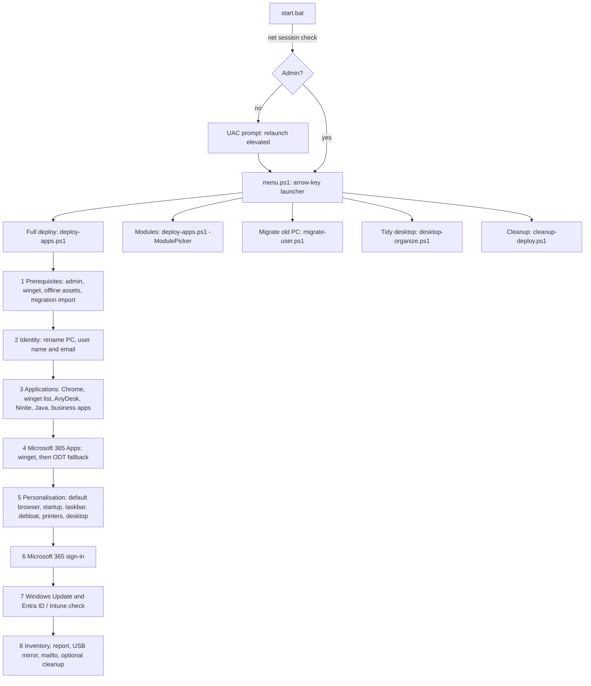

# windows-usb-provisioning

A PowerShell and batch kit, carried on a USB stick, that turns a freshly unboxed Windows 11 Pro machine into a ready-to-use workstation for an organisation running Entra ID, Intune and Microsoft 365 Business Premium.

It was generalised from a kit used in production. Organisation values (names, sites, email domain, report recipients, printers, business apps) live in a git-ignored `config.local.psd1`. A few defaults are still hard-coded in `deploy-apps.ps1`: French as the Office and Firefox language, the taskbar pin set and the startup allow-list.

## Problem

Small organisations often buy retail Windows 11 Pro machines. These have no Autopilot hardware hash, so Intune can enrol them (through "Set up for work or school" during OOBE) but cannot fully prepare them. After enrolment someone still has to:

- name the machine according to a convention,
- install the browser, Microsoft 365 Apps, remote support and line-of-business tools,
- move the user's files, bookmarks and saved passwords from the old PC,
- clean up the desktop, taskbar and startup apps,
- record what was done.

Done by hand, this takes a long time and comes out slightly different on every machine. This kit makes it one double-click plus a series of console prompts. Steps report OK, SKIP or FAIL (with INFO lines in between), and the run ends with a summary and an inventory report.

## How it works

This is not a boot USB: there is no WinPE and no imaging. The operator finishes OOBE on the new machine with a work account, which triggers the Entra join and Intune auto-enrolment. Then they plug in the stick and run `start.bat` from the logged-in session.

- **`start.bat`** checks for admin rights with `net session`. If they are missing, it relaunches itself through UAC, then starts `menu.ps1`.
- **`menu.ps1`** is an arrow-key menu with five entries: full deploy, module picker, old-PC migration, desktop tidy-up, and cleanup of script copies left on the desktop.
- **`deploy-apps.ps1`** runs the eight steps above. `-ModulePicker`, `-Modules <ids>` and `-ListModules` let you re-run single steps (Chrome import, startup apps, taskbar, printers, Office…) without a full deploy. Steps run in dependency order.
- **`migrate-user.bat` / `migrate-user.ps1`** run on the *old* PC, without admin rights, in the user's own session. They:
  - list the top level of Desktop, Documents and Downloads as a checklist,
  - copy the selected items to the stick (folders and files over 512 MB with `robocopy`, smaller files with `Copy-Item`),
  - guide a per-profile Chrome password export,
  - convert the Chrome bookmarks JSON to HTML,
  - write a manifest.

  On the new PC, the deploy finds the pack and imports it.
- **`desktop-organize.ps1`** keeps one shortcut per "hero" app on the user's desktop (Chrome, Word, Excel, plus the configured business apps). It moves every other shortcut to `_Inbox\Applications` and every other file to `_Inbox`.
- **`cleanup-deploy.ps1`** removes copies of `deploy-apps.ps1` / `deploy-apps.bat` from the desktop (and `Desktop\scripts`) after an explicit typed confirmation, then empties the whole Recycle Bin. It never touches the USB stick.
- **`lib/common.ps1`** loads `config.local.psd1` and builds the hostname regex from it. Every script dot-sources it.

## Technical choices and trade-offs

- **Windows PowerShell 5.1, no modules.** It ships with every Windows 11 machine, so nothing needs to be installed before the first step. The cost: files must be UTF-8 *with BOM*. UI glyphs are built from `[char]` codes, but other strings still contain literal non-ASCII characters, so without the BOM Windows PowerShell 5.1 misreads them and the scripts can fail to parse.
- **Config as a `.psd1` data file.** `Import-PowerShellDataFile` accepts only literals, so the config can never run code. Without `config.local.psd1`, the kit falls back to `config.example.psd1`, warns, and refuses to rename the PC or send the report.
- **Fallback chains instead of a single installer source.** Each app goes through some or all of:
  1. winget,
  2. a local offline folder on the stick,
  3. a direct vendor download (with `curl.exe` for CDNs that reject PowerShell's web client).

  AnyDesk skips winget; the optional camera client tries the offline folder and the download before winget. Office tries winget first and falls back to the Office Deployment Tool (`O365BusinessRetail`), because winget's Office manifest regularly fails on hash mismatch.
- **`mailto:` instead of SMTP or Outlook automation.** Sending needs no stored credentials and no configured mail profile. A `mailto:` launched from an elevated process often never reaches the user's mail client, so the script relaunches it through `explorer.exe` and writes a clickable `.url` file as a last resort. Attachments are dragged in by hand from the report folder, which the script opens.
- **Idempotent where it matters.** Installers check first (disk paths, `winget list`, `Get-Printer`, existing shortcuts) and report SKIP, so install steps can be re-run. Personalisation steps re-apply their settings. Re-running the migration import copies the pack again and overwrites files the user has changed since the first import.
- **Resumable identity.** The machine name and user identity are saved to a local JSON state file. It holds no secrets, expires after 14 days, and is ignored once a deploy has completed. Rename detects a rename that is already pending a reboot.
- **The stick is read-only from the scripts' point of view.** The only things they ever write to it are the report mirror and migration packs. Cleanup works on the local disk only and asks for a typed confirmation.

## What was hard

- **Winget is not a reliable single source.** Exit codes need a lookup table: "already installed" and "package not found" are easy to confuse, and hash mismatches need `--ignore-security-hash` or a different source. TLS pinning on some networks also had to be relaxed for winget.
- **Default apps on Windows 11.** `UserChoice` is protected by a hash. `DISM /Import-DefaultAppAssociations` only applies to new profiles. So the script applies it where it can, opens `ms-settings:defaultapps`, and asks the operator to confirm Chrome.
- **HKCU from an elevated session is the admin's hive.** Registry tweaks and startup entries are written to both HKCU and `HKU\<SID>` of the interactive user; the taskbar layout and desktop icon settings still go to the elevated account's profile. The SID is found through the owner of `explorer.exe`.
- **Disabling startup apps** writes a 12-byte binary value under `Explorer\StartupApproved\Run` (and `Run32`) and also removes the `Run` entry.
- **Taskbar pins** use `LayoutModification.xml` with `PinListPlacement="Replace"` and the matching policy.
- **The public desktop merges with the user's desktop**, so shortcuts show up twice. The desktop tidy-up keeps heroes on the user desktop only and merges duplicate `_Inbox` folders. It compacts icons once through the desktop's `FFlags` value, then turns auto-arrange back off.
- **`robocopy` through `Start-Process` breaks on paths with spaces.** `migrate-user.ps1` calls it directly with an argument array and decodes its exit-code bitmask (0–7 success, 8+ failure); the import step in `deploy-apps.ps1` still uses `Start-Process`.
- **Chrome password export is UI-only** because of app-bound encryption. Migration opens `chrome://password-manager/settings` in each profile in turn and collects the CSVs. Import happens the same way on the new machine. The CSVs are cleartext, so the scripts remind the operator to delete them.
- **NetBIOS names are limited to 15 characters.** The naming convention `<PREFIX>-<SITE>-<ITEM>-<NUM>` uses short codes, and the config loader warns if the longest possible name would exceed the limit.
- **Logging that degrades instead of failing.** In `deploy-apps.ps1`, status lines go through one `Write-Status` call, which writes a console line and a timestamped log line and (unless `-NoCount`) updates the OK/SKIP/FAIL counters; `migrate-user.ps1` and `desktop-organize.ps1` only write to the console. The log falls back from Documents to `%LOCALAPPDATA%` and `%TEMP%`. The USB mirror is best-effort, because the stick may be read-only (for example a locked BitLocker To Go volume).

## Getting started

1. Copy the repository to a USB stick, for example as `X:\scripts\`.
2. Copy `config.example.psd1` to `config.local.psd1` in the same folder and edit it. Save it as UTF-8 with BOM.
3. Fill `offline\` with installers. See `offline/README.txt`: AnyDesk, the Office Deployment Tool, printer drivers, a Ninite bundle, and the business-app folders declared in the config. The preflight treats the Office Deployment Tool and any configured business-app folders as critical and asks before continuing without them; the rest is optional.
4. On the new PC, finish OOBE with the user's work account. Then plug in the stick and double-click `start.bat`.
5. On an old PC being replaced, run `migrate-user.bat` beforehand, *without* admin rights, logged in as the user.

The scripts look for `lib\common.ps1` and the config next to themselves first, then under `X:\scripts\` on any drive. This means a copy of `deploy-apps.ps1` on the desktop still finds the library, the config and the offline folder while the stick is plugged in; the desktop tidy-up step also needs `desktop-organize.ps1` next to it.

## Configuration

All keys live in `config.local.psd1`. `config.example.psd1` documents each one with placeholder values.

| Key | Purpose |
|---|---|
| `OrgName` | Short name shown in banners, the report header, the mail subject and the local-account description |
| `OrgPrefix` | Hostname prefix in `<PREFIX>-<SITE>-<ITEM>-<NUM>` |
| `Sites` | List of `@{ Code; Name }`. Codes are part of the hostname regex and the prompt |
| `ItemTypes` | List of `@{ Code; Hint }` (PC, LAP, SRV, TAB…) |
| `EmailDomain` | Work email domain. The email is derived as first-name initial + surname |
| `ReportTo` | `mailto:` recipients for the deploy report |
| `SmtpServer`, `SmtpPort`, `SmtpUser`, `SmtpEnabled` | Kept for reference. Sending uses `mailto:` only |
| `NetworkDrives` | List of `@{ Letter; Path }` mapped persistently |
| `Printers` | TCP/IP (`HostAddress`, `DriverName`, `PortName`) or shared (`Path`) printers |
| `WingetApps` | List of `@{ Name; Id }` installed through winget, with direct-download fallbacks for known IDs |
| `NiniteFileNames` | Ninite bundle file names to look for in `offline\` |
| `OfflineMarkers` | Files or folders that identify a valid offline asset folder |
| `PortableApp` | Optional portable app copied to `LocalAppRoot`, with a Start Menu shortcut and a desktop hero |
| `LobApp` | Optional Java business client: folder copy, launcher JAR first run, process kill list, hero matching patterns |
| `ClickOnceApp` | Optional ClickOnce app: `.appref-ms` names, URL, installed-detection patterns |
| `PrinterDriverNames`, `PrinterDriverLabel`, `PrinterDriverFolders`, `PrinterInfExcludeDirPattern`, `PrinterInfExcludeNamePattern` | Printer driver package staged from `offline\printers\` with `pnputil` |
| `CameraClientEnabled` and the other `CameraClient*` keys | Optional camera-client install chain (offline setup or zip, then archive download URL `CameraClientArchiveUrl`, then winget), with all names, patterns and IDs in config |
| `FilePrefix` | Prefix for generated files (state JSON, migration manifest, Chrome export copies, temp files) |
| `WorkFolderName` | Sub-folder name under `%TEMP%`, `%LOCALAPPDATA%` and `%ProgramData%` |
| `ReportFolderName` | Report folder under Documents |
| `UsbReportsFolder` | Report mirror folder on the stick |
| `NoteFileName` | File name of the short notes written next to reports and migration packs |
| `LocalAppRoot` | Install root for copied business apps |
| `StartMenuFolder` | Start Menu folder for created shortcuts |
| `UserAgent` | User-Agent sent to the GitHub API when resolving the latest releases |

## Status and limitations

- The kit is a working tool, not a product. The UI prompts and most comments are in French. Yes/no prompts accept `o/oui/y/yes`.
- It is interactive by design: names, passwords and confirmations are typed at the console. It is not a replacement for Autopilot or for Intune policy.
- It targets Windows 11 Pro with Windows PowerShell 5.1 and has no automated tests. This anonymised, config-driven version has been checked statically (every `.ps1` parses with PowerShell 7.6, both config files load with `Import-PowerShellDataFile`) but has not yet been run end to end on a fresh Windows machine. Run it on a test machine first.
- Printer driver staging expects an unpacked vendor driver package (INF files) in `offline\printers\`, named in the config. Only one driver family is handled per kit.
- Logs and reports contain machine and user data, including part of `dsregcmd /status` output. If the local-account step generates a password, it is shown once on screen. Keep the report folder and the stick under the same care as any other personal data. Never commit `reports\` or `config.local.psd1`; `.gitignore` excludes both.
- Offline installers are not included. Their licences are the operator's responsibility.

## License

MIT. See [LICENSE](LICENSE).
